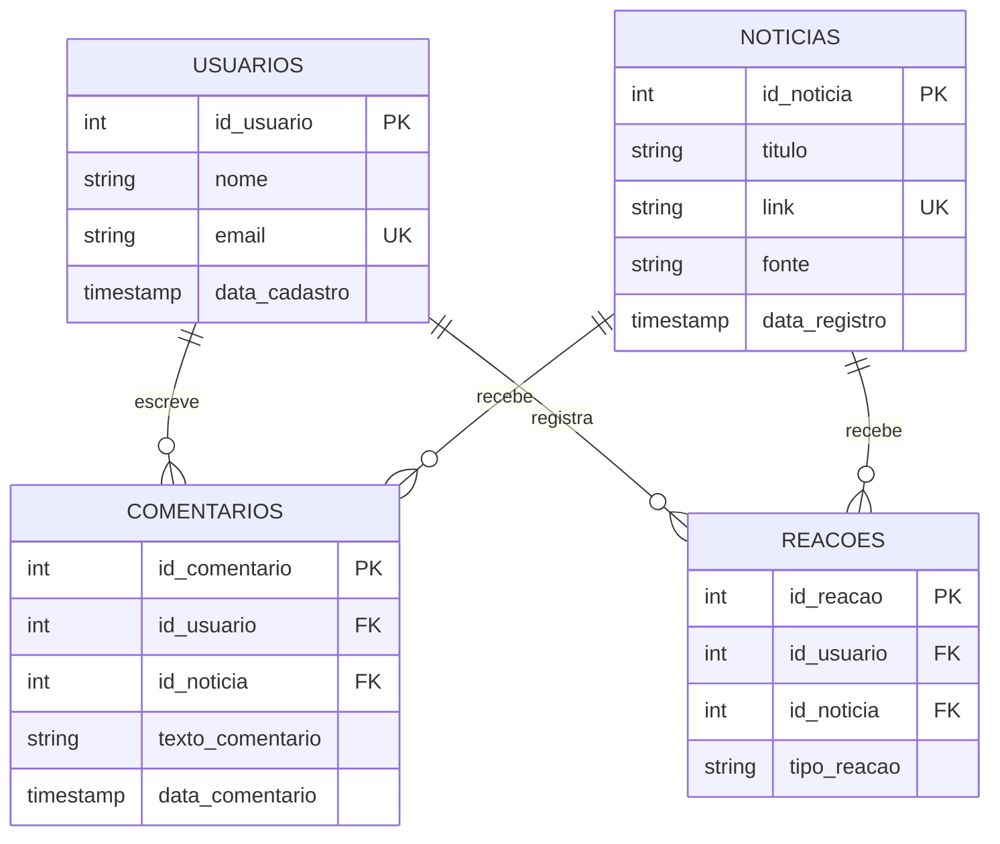

# Agregador de Notícias — Fase 1 (revisão para estudo)

> **Versão revisada após a entrega original.** O projeto e seus arquivos anteriores continuam no repositório. Os dados usados aqui são fictícios, somente para testes.

## 1. Objetivo e público-alvo

Criar um banco de dados relacional no PostgreSQL para registrar notícias (título, link e fonte) e permitir que usuários publiquem comentários e reações. O público-alvo são leitores interessados em acompanhar notícias e interagir com elas.

## 2. Modelo entidade-relacionamento



**Como ler:** um usuário pode criar vários comentários, mas cada comentário pertence a um usuário e a uma notícia. O mesmo princípio vale para as reações.

**Regras:** `PRIMARY KEY` identifica os registros; `FOREIGN KEY` conecta as tabelas e impede referências inexistentes; `NOT NULL` obriga preenchimento; `UNIQUE` impede e-mails e links repetidos e limita a uma reação por usuário/notícia; `CHECK` aceita apenas os tipos de reação previstos.

## 3. O que há nos arquivos

| Arquivo | Para que serve | Conceitos |
| --- | --- | --- |
| `scripts/V2__criar_tabelas.sql` | Cria as quatro tabelas | `CREATE TABLE`, PK, FK, `NOT NULL`, `UNIQUE` |
| `scripts/V2__inserir_dados.sql` | Insere dados fictícios | `INSERT`, `VALUES` e prevenção de duplicidade |
| `scripts/V2__consultar_testes.sql` | Exibe e conta dados; relaciona comentários | `SELECT`, `COUNT` e um exemplo de `JOIN` |
| `scripts/V2__atualizar_excluir.sql` | Atualiza um nome e exclui uma reação específica | `UPDATE`, `DELETE`, `WHERE` |

**Por que ainda existem consultas mais elaboradas no script de inserção?** O código procura os usuários por e-mail e as notícias pelo link, em vez de presumir que terão IDs 1 e 2. Também evita comentários duplicados quando executado novamente. Retirar essas verificações tornaria a explicação mais curta, mas deixaria o teste menos confiável.

## 4. Como executar no Fedora

Use **um banco de teste novo e vazio**, para não misturar com a tabela `usuarios` que já foi criada anteriormente no `agregador_noticias_estudo`. Os comandos abaixo são executados no terminal Linux, a partir da raiz do repositório Fase 1:

```bash
sudo -u postgres createdb -O joaosousa agregador_noticias_fase1
psql -U joaosousa -d agregador_noticias_fase1 -v ON_ERROR_STOP=1 -f versao-corrigida/scripts/V2__criar_tabelas.sql
psql -U joaosousa -d agregador_noticias_fase1 -v ON_ERROR_STOP=1 -f versao-corrigida/scripts/V2__inserir_dados.sql
psql -U joaosousa -d agregador_noticias_fase1 -v ON_ERROR_STOP=1 -f versao-corrigida/scripts/V2__consultar_testes.sql
psql -U joaosousa -d agregador_noticias_fase1 -v ON_ERROR_STOP=1 -f versao-corrigida/scripts/V2__atualizar_excluir.sql
psql -U joaosousa -d agregador_noticias_fase1 -v ON_ERROR_STOP=1 -f versao-corrigida/scripts/V2__consultar_testes.sql
```

O primeiro comando cria o banco de testes. **Execute-o apenas uma vez.** Os demais executam os arquivos SQL na ordem. Se algum comando apresentar erro, pare e corrija antes de continuar. O script de atualização/exclusão altera dados fictícios; execute somente no banco de testes.

> `CREATE TABLE IF NOT EXISTS` evita erros ao criar uma tabela que já existe, **mas não corrige a estrutura de uma tabela antiga**. Por isso usamos um banco separado e vazio.

## 5. O que foi corrigido

- Incluído o diagrama ER solicitado pela atividade.
- Organizados os scripts e documentada a ordem de execução.
- Inseridas restrições para evitar links e reações repetidos.
- Trocada a dependência de IDs fixos por buscas usando e-mail e link.
- Simplificadas as **consultas de teste**: saíram a contagem com `UNION ALL` e uma segunda consulta com `JOIN` de três tabelas. Os testes principais permanecem.
- Mantidas algumas verificações mais elaboradas no script de inserção para evitar inconsistências.

## 6. Limitações

Este projeto implementa o **banco de dados relacional** de um agregador de notícias, não sendo uma aplicação completa com login funcional ou coleta automática de notícias.

Os dados utilizados são fictícios e destinados à demonstração e aos testes das funcionalidades do banco.

Os scripts foram executados e testados localmente no **PostgreSQL 18.3**, em 24/11/2026. Foram verificadas a criação das quatro tabelas, a inserção de registros, as consultas com SELECT e JOIN, além das operações UPDATE e DELETE.

O projeto ainda não possui uma interface integrada ao banco de dados.

Os arquivos originais foram preservados no repositório. Esta versão corrigida foi desenvolvida posteriormente à entrega inicial, com melhorias na modelagem, na documentação e nos scripts SQL.
